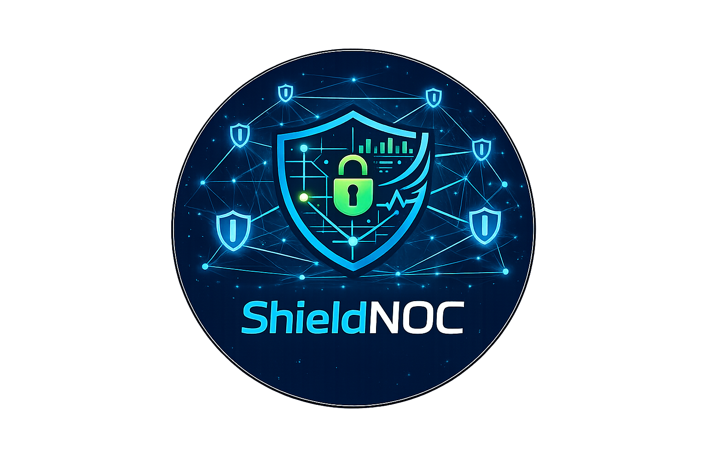
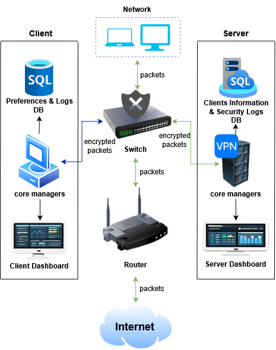
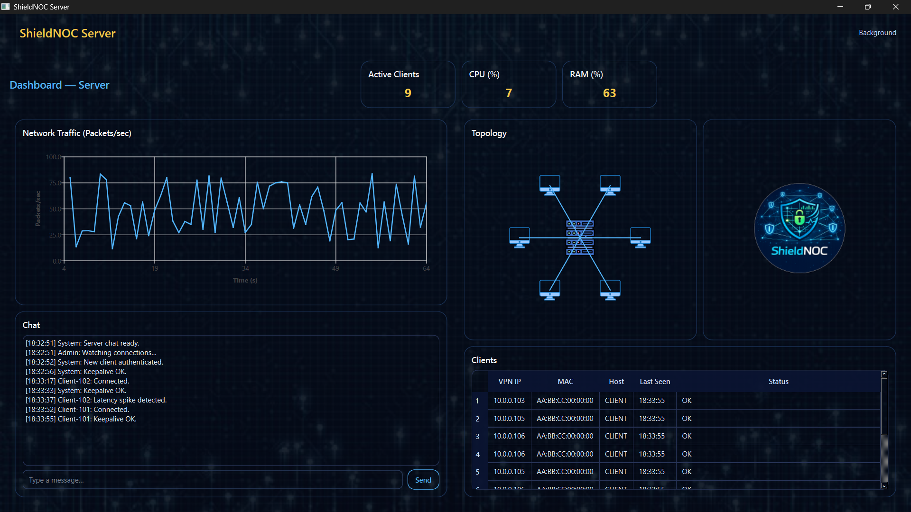
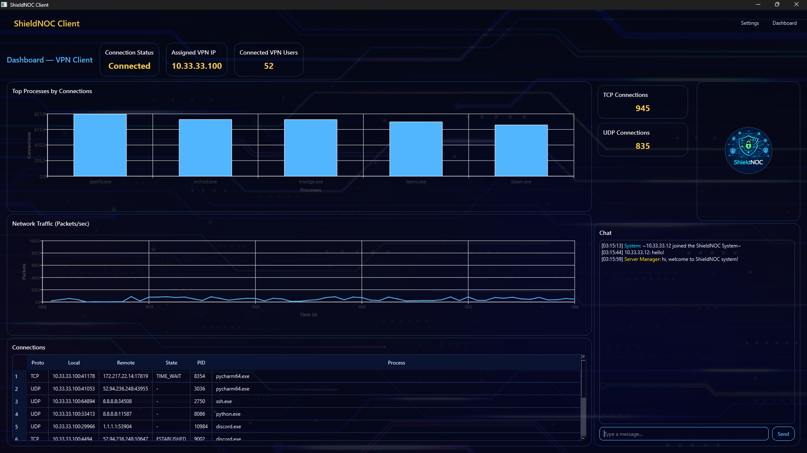
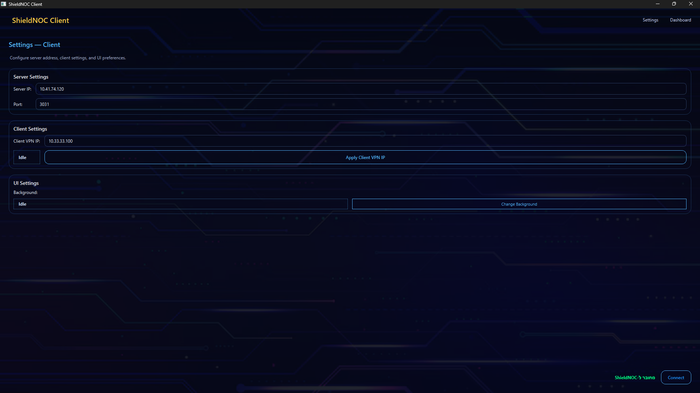

# ShieldNOC


ShieldNOC is a local VPN management system built on top of WireGuard.
The project demonstrates how encrypted tunneling, IP forwarding, and NAT
work together inside a Local Area Network (LAN).

---

## 🎯 Main Goals

- Implement a local encrypted VPN (WireGuard-based)
- Route all client traffic through a central Linux server (Full Tunnel)
- Perform IP Forwarding and NAT on the server
- Manage connected clients via a central database
- Display connection status and traffic statistics
- Provide internal chat between connected users

---

## 🖥️ System Overview & Screenshots

### System Architecture

<p align="center">
  
</p>

### Server Dashboard

<p align="center">
  
</p>

### Client Dashboard

<p align="center">
  
</p>

### Client Settings

<p align="center">
  
</p>

---

## ⚙️ Installation Guide

### Required Environment

#### Server Side
- Linux operating system
- Python 3.10 or higher
- Active internet connection
- sudo privileges

The server requires permissions for:
- Running WireGuard
- Modifying network settings
- Enabling NAT
- Enabling IP Forwarding
- Using iptables

---

#### Client Side
- Windows 10/11
- Python 3.10 or higher
- winget package manager
- Active internet connection

---

## 📦 Required Dependencies

### Server Side

Install the required packages:

```bash
sudo apt install wireguard iptables python3-pip
```

Install the project dependencies:

```bash
pip install -r requirements.txt
```

---

### Client Side

Install the project dependencies:

```powershell
pip install -r requirements.txt
```

WireGuard installation is handled automatically by the client when required.

---

## 📁 Automatically Generated Files

The system automatically creates the required files inside the current working directory.

### Server Side
- `shieldnoc.conf`
- `shieldnoc.db`

### Client Side
- `shieldnoc.conf`
- `wg.keys`

---

## 🚀 Running The Project

### Server Side

Run the server from the `src` directory:

```bash
‫‪shieldnoc.server.main‬‬‫‪-m‬‬ ‫‪/home/.../shieldnoc/.venv/bin/python‬‬ ‫‪sudo‬‬
```

---

### Client Side

Run the client from the `src` directory:

```powershell
python -m shieldnoc.client.main
```

---

## 📝 Notes

- Running the client with administrator privileges is recommended to avoid UAC-related permission issues.
- When using an IDE such as PyCharm, virtual environment activation is usually handled automatically by the configured interpreter.
